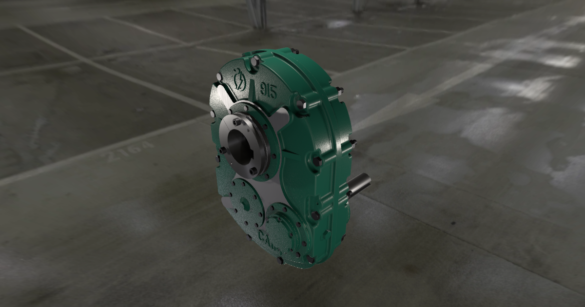

# CAIM 915 — редуктор в браузере / gearbox in the browser

**Открыть: https://axma88.github.io/caim-915-gearbox/**

## По-русски

Интерактивная **концепт-модель редуктора CAIM 915** прямо в браузере — на компьютере, Android и iPhone, без установки программ.

Модель сделана в Autodesk Fusion 360 и подготовлена в Autodesk VRED (материалы, освещение, анимации). В браузер её перенесли с помощью Claude Code (Anthropic): сцена VRED выгружена в glTF и показана средствами three.js — окружение, материалы, запечённые тени, подсветка и анимации повторяют исходную сцену.

### Управление
- **Разобрать / Собрать** — разборка и сборка редуктора (6 с).
- **Картер, Крышка, Муфты** — показать или скрыть части.
- **Подсветка** — включить или выключить подсветку.
- **◀ ■ ▶ ⟲** — вращение шестерён назад, пауза, вперёд, сброс в исходное положение.
- **⌂** — вид по умолчанию; **Облёт** — облёт камеры вокруг модели за 10 с.
- **Качество** — высокое (мощные ПК), среднее (ПК), низкое (телефоны); выбирается автоматически при открытии.
- Камера: мышь — вращение (левая кнопка), приближение (колесо), сдвиг (средняя или правая кнопка); на телефоне — один палец, щипок, два пальца.

## In English

An interactive **concept model of the CAIM 915 gearbox** right in the browser — on a computer, Android or iPhone, nothing to install.

The model was built in Autodesk Fusion 360 and prepared in Autodesk VRED (materials, lighting, animations). It was brought to the browser with the help of Claude Code (Anthropic): the VRED scene was exported to glTF and rendered with three.js — the environment, materials, baked shadows, lighting and animations follow the original scene.

### Controls
- **Разобрать / Собрать** (Explode / Assemble) — take the gearbox apart and put it back together (6 s).
- **Картер, Крышка, Муфты** (Housing, Cover, Couplings) — show or hide parts.
- **Подсветка** (Lights) — switch the lighting on or off.
- **◀ ■ ▶ ⟲** — rotate the gears backward, pause, forward, reset to the initial position.
- **⌂** — default view; **Облёт** (Orbit) — a 10-second camera orbit around the model.
- **Качество** (Quality) — high (powerful PCs), medium (PCs), low (phones); chosen automatically on start.
- Camera: mouse — rotate (left button), zoom (wheel), pan (middle or right button); on a phone — one finger, pinch, two fingers.
